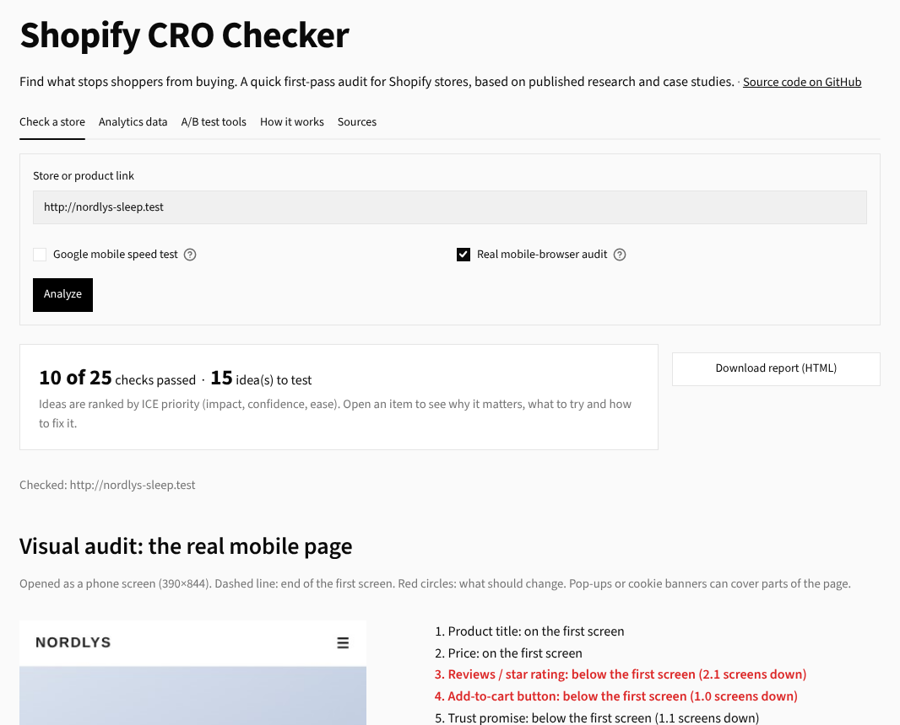
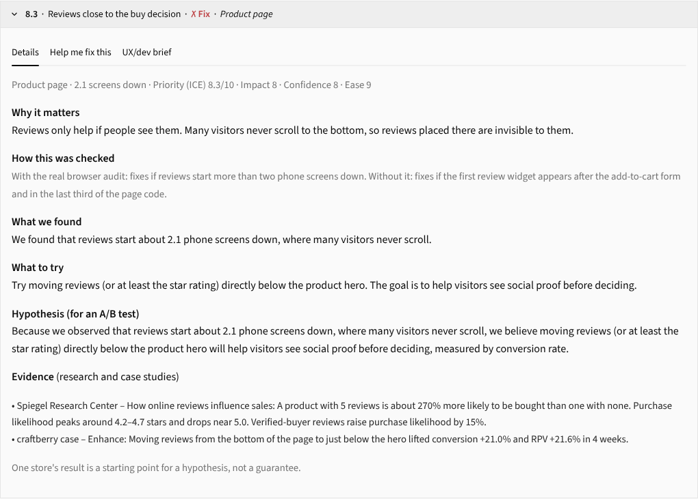
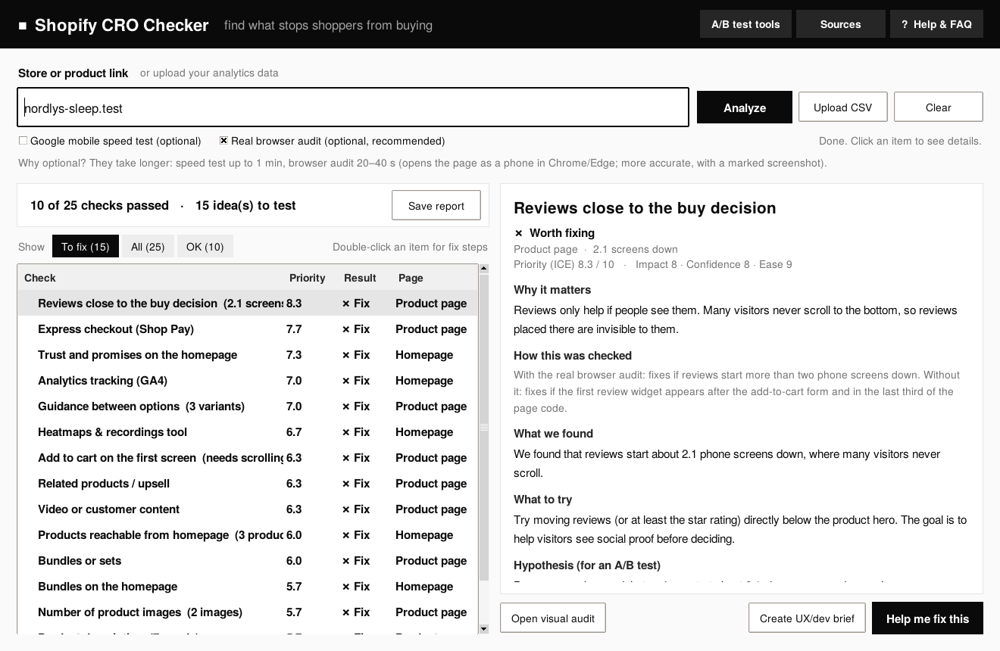
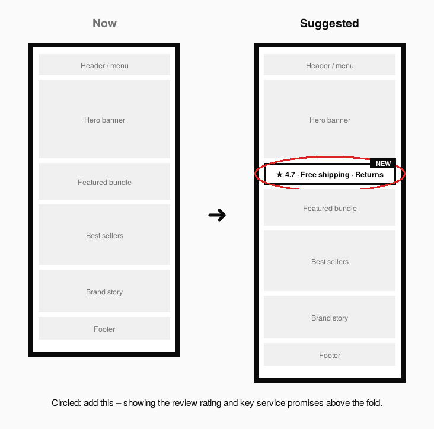
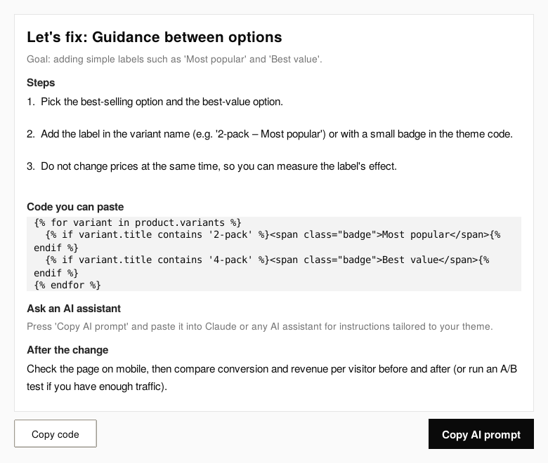
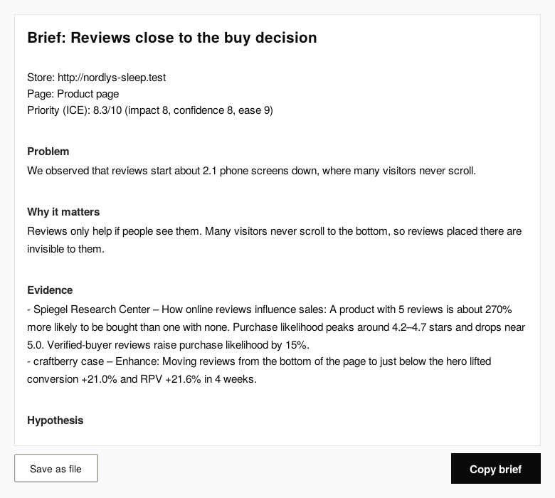
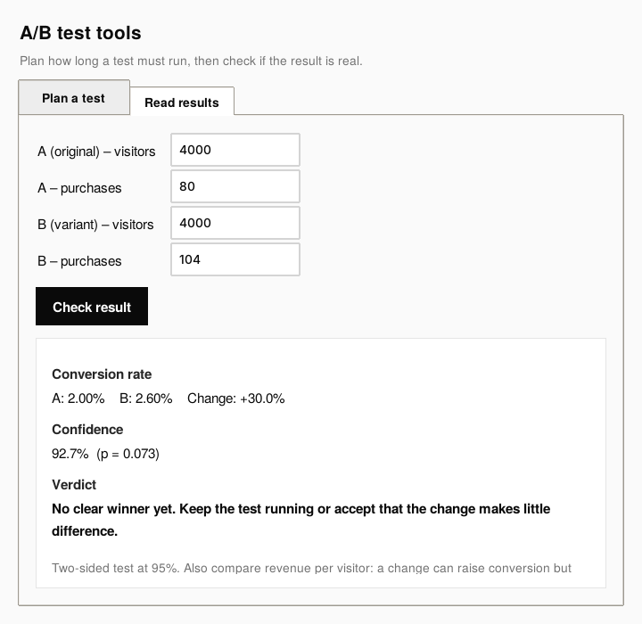
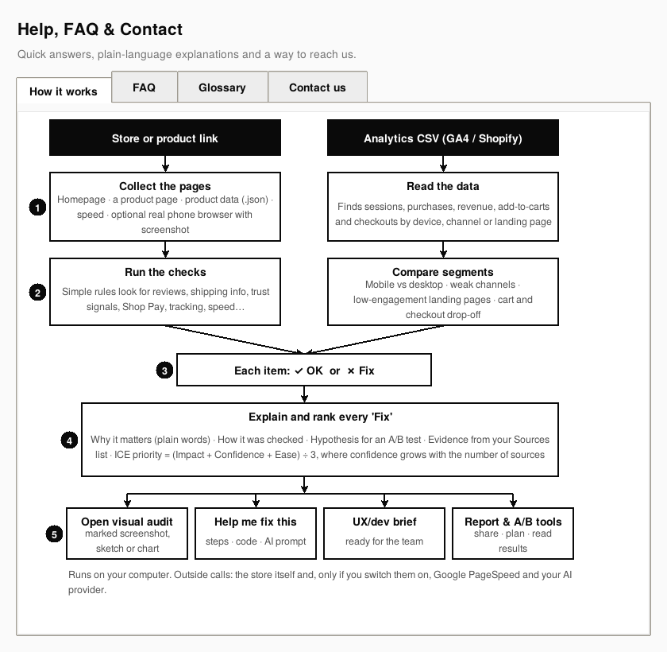
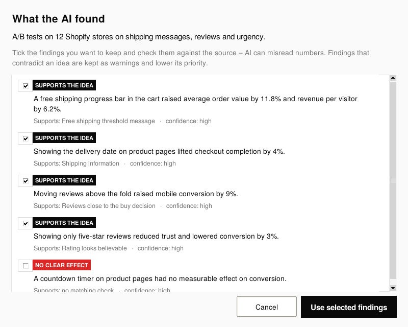
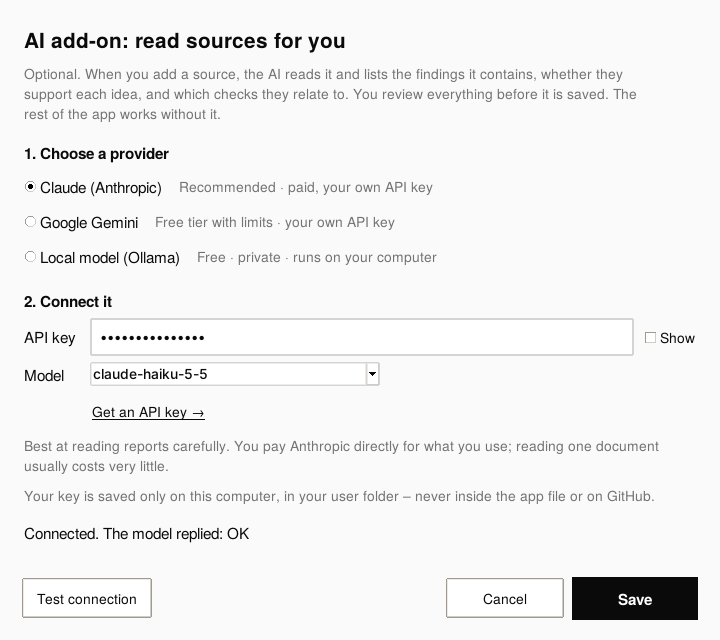

# Shopify CRO Checker


A tool that audits a Shopify store the way a CRO team works: find friction, explain why it matters, write a testable hypothesis, rank the ideas and hand them to the team.

**Try it in your browser:** [shopify-cro-checker.streamlit.app](https://shopify-cro-checker.streamlit.app). No installation needed. There is also a desktop version with a few extra features (see below).

I built it while learning conversion rate optimisation, to practise the full process on real stores: research, hypotheses, prioritisation, briefs and A/B test analysis.

## What it does

- **Checks a store against 27 CRO rules** on the homepage and a product page: reviews and where they sit, shipping and returns info, trust signals, express checkout, bundles, upsell, images, variant guidance, sale savings, tracking tools, page weight and mobile speed.
- **Real mobile-browser audit** (optional): opens the product page as a phone in Chrome or Edge, measures where key elements are, and returns a screenshot with red circles on what should change and a line where the first screen ends.
- **Reads your analytics data**: upload a CSV export from Google Analytics 4 or Shopify Analytics to compare devices, channels, landing pages, and cart and checkout drop-off (6 data checks).
- **Explains every finding in plain language**: why it matters, how it was checked, and a hypothesis in the form *"Because we observed X, we believe Y will help Z, measured by M."*
- **Ranks ideas with ICE** (impact, confidence, ease). Confidence grows with the number of sources behind an idea.
- **Shows the evidence**: research (Baymard Institute, Spiegel Research Center, Deloitte/Google, Shopify) and published case studies. You can add or remove sources, including your own PDFs and documents. Sources don't change what is checked; they back up ideas and move well-supported ones up the list.
- **AI add-on (optional)**: reads a source you add (web page, PDF, Word or text) and lists its findings, whether each one supports or contradicts an idea, and which checks it relates to. You review everything before it is saved. Works with Claude (your own API key), Google Gemini (free tier with limits) or a free local model through Ollama.
- **Helps the team act**: step-by-step fixes with Liquid/HTML code and a ready-made AI prompt, plus a UX/dev brief with a QA checklist and measurement plan.
- **A/B test tools**: how many visitors and weeks a test needs, and whether a result is significant.
- **Shareable report**: one HTML page with the marked screenshot, prioritised ideas and evidence.

## Screenshots

| | |
|---|---|
|  |  |
| Web version: paste a link, get ranked ideas | Each idea explained, with evidence |
|  |  |
| Results ranked by priority, with plain-language details | Real mobile-browser audit with red circles |
|  |  |
| Before/after sketch for each idea | Fix steps, code and an AI prompt |
|  |  |
| Brief for designers and developers | A/B test planner and result checker |
|  |  |
| Findings from an analytics export | Built-in help, FAQ and diagram |
|  |  |
| AI add-on: findings read from a source, ready to review | Choose Claude, Gemini or a local model |

The screenshots use a demo store (*Nordlys*, not a real brand) and sample analytics data.

## How to run

### Web version

Open [shopify-cro-checker.streamlit.app](https://shopify-cro-checker.streamlit.app), paste a store link and press Analyze.

To run it on your own computer (Python 3.10 or newer):

```bash
pip install -r requirements.txt
streamlit run streamlit_app.py
```

### Desktop version

The desktop app also lets you add your own sources (links, PDFs, Word files) and read them with the optional AI add-on.

```bash
pip install requests beautifulsoup4 pypdf playwright
```

Then double-click `shopify_cro_checker.pyw` (or run `python shopify_cro_checker.pyw`). Keep `cro_core.py` in the same folder.

The real mobile-browser audit uses Playwright with the Chrome or Edge already on your computer. If you have neither, run once:

```bash
python -m playwright install chromium
```

To try the analytics feature, use the files in `samples/`.

**AI add-on (optional, desktop):** press *AI add-on* at the top, pick a provider and paste your own API key (or install Ollama for a free local model). The key is saved only in a settings file in your user folder, never in the repository.

### Project structure

| File | What it is |
|---|---|
| `cro_core.py` | The checks, store analysis, scoring, evidence, analytics, A/B maths and report. Shared by both versions. |
| `streamlit_app.py` | Web version |
| `shopify_cro_checker.pyw` | Desktop version (Tkinter) |
| `samples/` | Example analytics exports |

## How it works

1. **Collect**: the homepage, a product page (found through `/products.json` or a homepage link), the product data (`.json`), and optionally Google PageSpeed and a real mobile browser.
2. **Check**: simple, transparent rules. Every result shows the exact rule it used.
3. **Explain and rank**: why it matters, a hypothesis, evidence from the sources list, and an ICE score.
4. **Act**: visual audit, fix steps, UX/dev brief, A/B test tools and a shareable report.

The desktop version runs on your computer. Its only outside calls are to the store itself and, if switched on, Google's free PageSpeed API and the AI provider you chose. The web version does the same checks on a server, saves nothing you enter, and only opens public web addresses.

## Limitations

- Built for Shopify stores. Other platforms only get the general checks.
- Rules read the page, they don't understand it. Some themes or apps can cause a false alarm, so treat results as ideas to test, not verdicts.
- Thresholds for analytics findings are rules of thumb, not industry benchmarks.
- A result from one store or case study does not guarantee the same result elsewhere.
- Some stores block automated visits, especially from cloud servers. The web version then can't read the page; the desktop version usually can.

## Sources and credits

The evidence shown in the app is short summaries, in my own words, of publicly available research and case studies. Each one links to the original. All rights belong to their authors, and this project is not affiliated with or endorsed by any of them.

- Baymard Institute – [Reasons for checkout abandonment](https://baymard.com/blog/reduce-cart-abandonment)
- craftberry – published [case studies](https://craftberry.co/work) and CRO articles
- Deloitte and Google – [Milliseconds Make Millions](https://web.dev/case-studies/milliseconds-make-millions)
- Shopify – [Shopify Checkout and Shop Pay](https://www.shopify.com/enterprise/blog/shopify-checkout) (vendor study)
- Spiegel Research Center, Northwestern University – [How online reviews influence sales](https://www.xait.com/hubfs/Spiegel_Online-Review_eBook_Jun2017_FINAL.pdf)

If you are an author and would like a summary changed or removed, please get in touch.

## Tech

Python, Streamlit, Tkinter, Requests, BeautifulSoup, Playwright, pypdf, Google PageSpeed Insights API, Claude API (optional).

## Author

Alper Kizik · [LinkedIn](https://www.linkedin.com/) · alperhasankizik@gmail.com

## License

MIT
