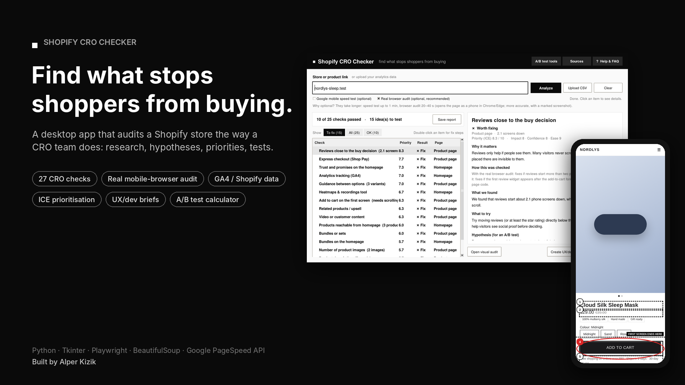
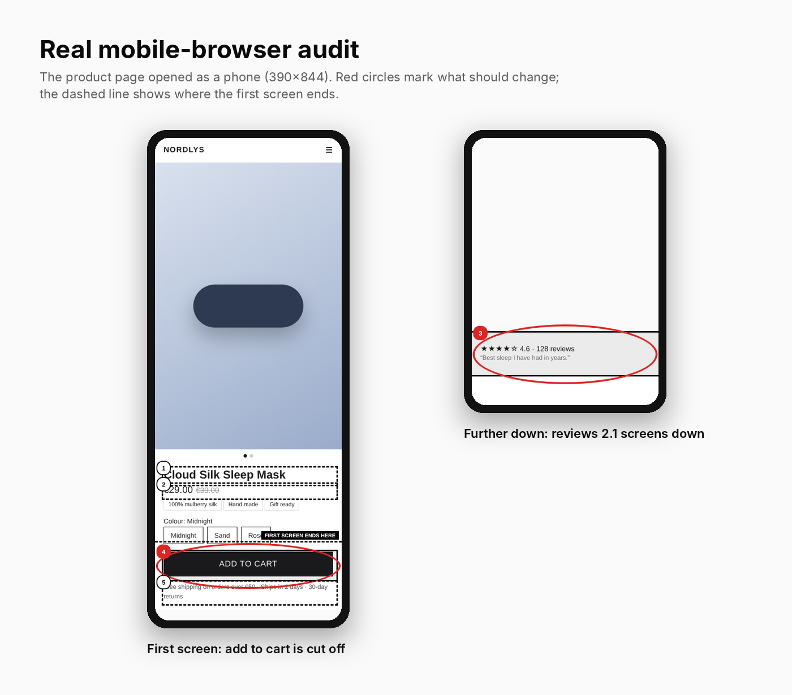
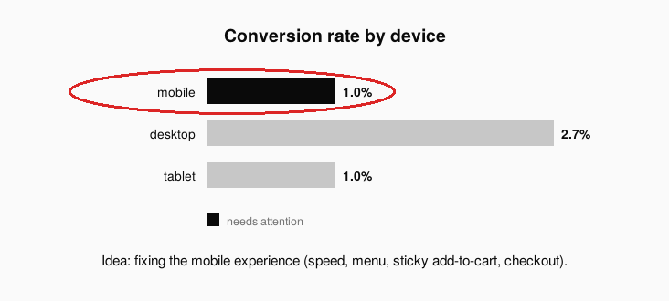
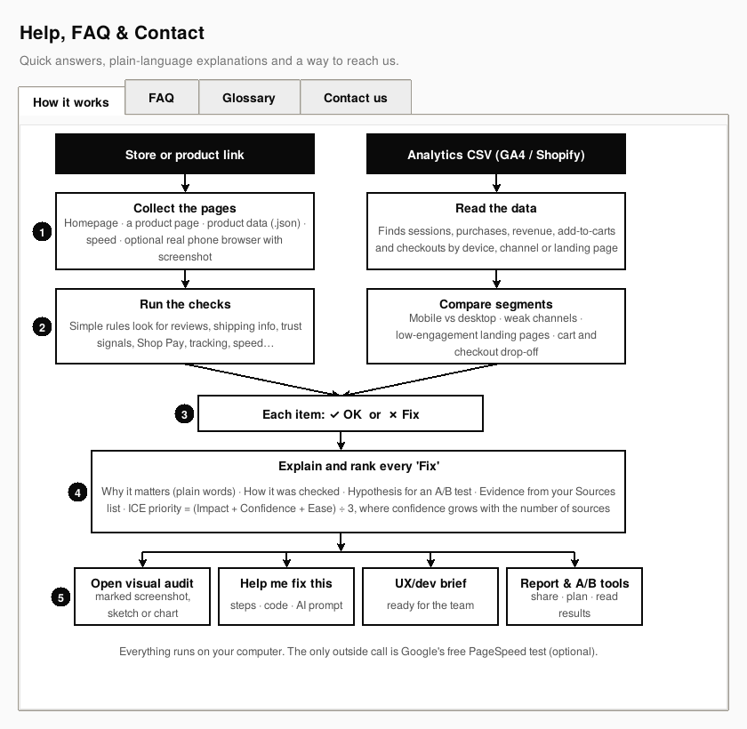

# Shopify CRO Checker



A desktop app that audits a Shopify store the way a CRO team works: find friction, explain why it matters, write a testable hypothesis, rank the ideas and hand them to the team.

I built it while learning conversion rate optimisation, to practise the full process on real stores: research, hypotheses, prioritisation, briefs and A/B test analysis.

## What it does

- **Checks a store against 27 CRO rules** on the homepage and a product page: reviews and where they sit, shipping and returns info, trust signals, express checkout, bundles, upsell, images, variant guidance, sale savings, tracking tools, page weight and mobile speed.
- **Real mobile-browser audit** (optional): opens the product page as a phone in Chrome or Edge, measures where key elements are, and returns a screenshot with red circles on what should change and a line where the first screen ends.
- **Reads your analytics data**: upload a CSV export from Google Analytics 4 or Shopify Analytics to compare devices, channels, landing pages, and cart and checkout drop-off (6 data checks).
- **Explains every finding in plain language**: why it matters, how it was checked, and a hypothesis in the form *"Because we observed X, we believe Y will help Z, measured by M."*
- **Ranks ideas with ICE** (impact, confidence, ease). Confidence grows with the number of sources behind an idea.
- **Shows the evidence**: research (Baymard Institute, Spiegel Research Center, Deloitte/Google, Shopify) and published case studies. You can add or remove sources, including your own PDFs and documents.
- **Helps the team act**: step-by-step fixes with Liquid/HTML code and a ready-made AI prompt, plus a UX/dev brief with a QA checklist and measurement plan.
- **A/B test tools**: how many visitors and weeks a test needs, and whether a result is significant.
- **Shareable report**: one HTML page with the marked screenshot, prioritised ideas and evidence.

## Screenshots

| | |
|---|---|
|  |  |
| Results ranked by priority, with plain-language details | Real mobile-browser audit with red circles |
|  |  |
| Before/after sketch for each idea | Fix steps, code and an AI prompt |
|  |  |
| Brief for designers and developers | A/B test planner and result checker |
|  |  |
| Findings from an analytics export | Built-in help, FAQ and diagram |

The screenshots use a demo store (*Nordlys*, not a real brand) and sample analytics data.

## How to run

Requires Python 3.10 or newer.

```bash
pip install -r requirements.txt
```

Then double-click `shopify_cro_checker.pyw` (or run `python shopify_cro_checker.pyw`).

The real mobile-browser audit uses Playwright with the Chrome or Edge already on your computer. If you have neither, run once:

```bash
python -m playwright install chromium
```

To try the analytics feature, use the files in `samples/`.

## How it works

1. **Collect**: the homepage, a product page (found through `/products.json` or a homepage link), the product data (`.json`), and optionally Google PageSpeed and a real mobile browser.
2. **Check**: simple, transparent rules. Every result shows the exact rule it used.
3. **Explain and rank**: why it matters, a hypothesis, evidence from the sources list, and an ICE score.
4. **Act**: visual audit, fix steps, UX/dev brief, A/B test tools and a shareable report.

Everything runs on your computer. The only outside calls are to the store itself and, if switched on, Google's free PageSpeed API.

## Limitations

- Built for Shopify stores. Other platforms only get the general checks.
- Rules read the page, they don't understand it. Some themes or apps can cause a false alarm, so treat results as ideas to test, not verdicts.
- Thresholds for analytics findings are rules of thumb, not industry benchmarks.
- A result from one store or case study does not guarantee the same result elsewhere.

## Tech

Python, Tkinter, Requests, BeautifulSoup, Playwright, Google PageSpeed Insights API.

## Author

Alper Kizik · [LinkedIn](https://www.linkedin.com/) · alperhasankizik@gmail.com

## License

MIT
